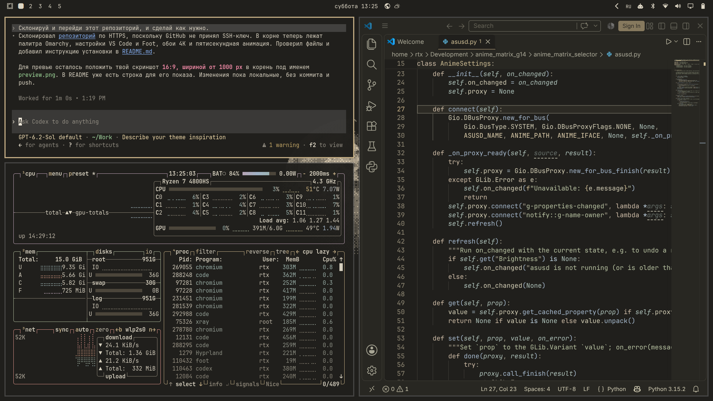
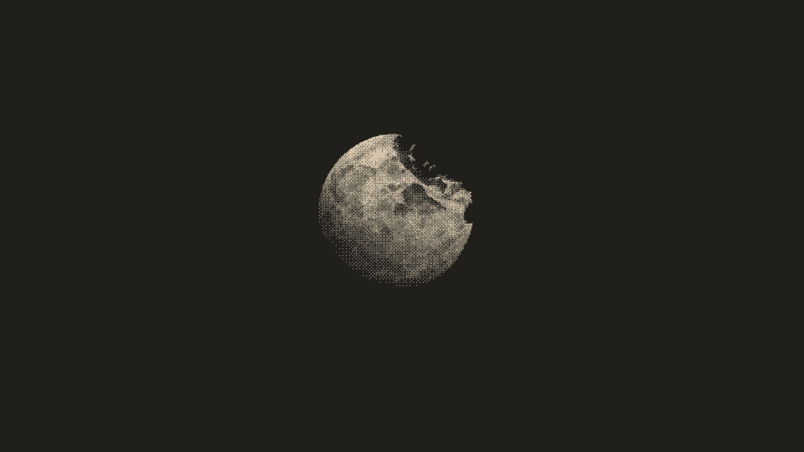

# NieR Lunar Graphite

A dark Omarchy theme inspired by NieR:Automata, with a dithered moon and a warm graphite palette.




## Install

```sh
omarchy theme install https://github.com/DR0P-database/omarchy-nier-lunar-graphite-theme
```

### Optional Foot colors

Omarchy regenerates `foot.ini` when installing themes from Git. To use the included Foot cursor and selection colors, copy the installed theme to a separate local directory, add this repository's `foot.ini` beside its `colors.toml`, and activate the local copy.

## Credits

This is an unofficial fan-made theme inspired by NieR:Automata.

- **Moon artwork** — the wallpaper was redrawn using an image featured on the [NIER Wiki Moon page](https://nier.fandom.com/wiki/Moon) as a visual reference. The wiki is the source of the reference. The original image's author and license have yet to be verified.
- **Animation** — the pixel-reveal intro was created for this theme, using the redrawn wallpaper and taking inspiration from [Flexoki Light Orb](https://github.com/omacom/omarchy/blob/quattro/themes/flexoki-light/backgrounds/1-orb.webp).
- **VS Code palette** — selected colors come from [PlatinumGames' NieR:Automata UI design notes](https://www.platinumgames.com/official-blog/article/9624). The HUD screenshot itself is not included.
- **Omarchy templates** — the VS Code and Foot configurations adapt upstream templates. See [Third-party notices](THIRD_PARTY_NOTICES.md) for the original copyright and MIT terms.

The repository's [MIT license](LICENSE) applies to the project's own contributions to the extent we can license them. It grants no rights to the third-party moon reference.
